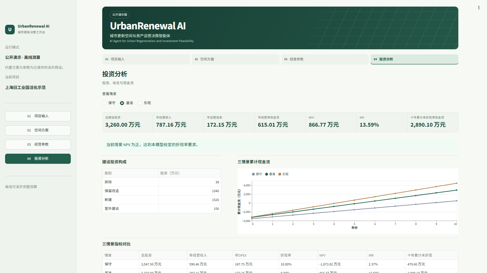

# UrbanRenewal AI

**城市更新空间与资产运营决策智能体**  
AI Agent for Urban Regeneration and Investment Feasibility

面向工业园区改造与工业遗产活化的决策工作台。把项目面积、室内外功能校验、三情景经营参数与十年投资测算放在同一流程中。



[项目输入截图](docs/screenshots/workbench-project.png) · [2.5D 空间方案截图](docs/screenshots/workbench-spaces.png)

## 四步操作

| 步骤 | 操作 |
|---|---|
| 项目输入 | 一键加载虚构示范项目，或自填项目并查看面积摘要。修改项目面积后，重新配置空间方案。 |
| 空间方案 | 编辑功能、经营方式、面积和收入项，点击「应用空间修改」更新面积校验和 2.5D 示意。各建设方式面积匹配后，确认方案。 |
| 经营参数 | 切换保守、基准、乐观情景，编辑并保存每套参数。可主动补录匹配的演示假设。检查全部情景后确认参数。 |
| 投资分析 | 执行十年测算，查看建设投资、营运收支、累计现金流、NPV 与 IRR。公开版可展开脱敏历史工具记录。 |

## 技术架构与运行模式

Streamlit 工作台通过 `space_model.py` 校验空间，再通过确认状态把固定输入交给 `project_finance.py`。后者使用 Python 计算三情景投资和运营结果，界面用 Altair 展示现金流。

| | 公开演示版 | 本地完整版 |
|---|---|---|
| 启用方式 | 设置 `PUBLIC_DEMO_MODE=true`。仅含公开部署文件的目录自动启用。 | 在原工作区使用已配置的 RAG 环境，保持开关未设置。 |
| 方案与参数 | 使用明确标记的内置演示或手动编辑。 | 另可在授权后使用实时 RAG、OpenAI 和 Agent 工具调用。 |
| 财务计算 | 真实 Python 引擎，无需凭据或知识库。 | 同一引擎，可由 Agent 调用。 |
| Agent 记录 | [脱敏历史摘要](examples/public_agent_history.json)，来自第四阶段的真实模型运行。两次用户确认由测试模拟。 | 实时模式可查看本会话工具记录。 |

## 本地启动

公开版使用 Python 3.11，在源码或解压后的公开部署目录执行：

```powershell
python -m pip install -r requirements.txt
$env:PUBLIC_DEMO_MODE = 'true'
python -m streamlit run urbanrenewal_app.py
```

macOS 或 Linux 使用 `PUBLIC_DEMO_MODE=true python -m streamlit run urbanrenewal_app.py`。浏览器打开 `http://localhost:8501`。

本地完整版在拥有原项目文件和本地 Chroma 数据的原工作区启动。激活原 RAG Conda 环境，清除公开模式变量（PowerShell 使用 `Remove-Item Env:PUBLIC_DEMO_MODE -ErrorAction SilentlyContinue`），再运行同一入口。首次搭建还需安装 `requirements-ui.txt`、`pandas` 和原 Mini RAG 的 `requirements-rag.txt`，并在本机按原流程配置 OpenAI 与 Chroma。原单年度财务计算器继续通过 `app.py` 启动。

## Streamlit Community Cloud 部署

1. 在原工作区运行 `python scripts/build_public_demo.py`，获取 `build/UrbanRenewal-AI-public.zip`，或使用交付的同名 ZIP。
2. 在 GitHub 创建一个新的公开仓库，将 ZIP **解压后的文件**上传到仓库根目录，保留隐藏目录 `.streamlit/`。部署包采用文件白名单。原工作区中的知识库、API 配置、原始测试日志和本地数据应留在本地。
3. 登录 [Streamlit Community Cloud](https://share.streamlit.io/)，点击 **Create app**，选择该 GitHub 仓库和 `main` 分支，入口填写 `urbanrenewal_app.py`。
4. 在 **Advanced settings** 选择 Python **3.11**，在 **Secrets** 填入以下非敏感开关。公开版无需 API Key，也无需部署系统依赖文件。点击 **Deploy** 后，从应用页面复制实际 `streamlit.app` 链接。 [Streamlit 官方部署说明](https://docs.streamlit.io/deploy/streamlit-community-cloud/deploy-your-app/deploy)

```toml
PUBLIC_DEMO_MODE = "true"
```

## 验证结果与财务口径

Python 3.11 RAG 环境中 91 项自动化测试通过（原有 86 项，新增 5 项）。在原工作区运行 `python -X utf8 -B -m unittest discover -s tests -q` 可复测。发布验证覆盖公开包无 API Key 和无 Chroma 下的离线完整流程、面积调整、确认和三情景重算。

历史真实 OpenAI 验证依次执行了 `search_cases`、`validate_space_plan`、`search_benchmarks` 和 `calculate_finance`。当前公开版计算发生在本次会话内，历史记录单独展示。

模型按人民币计算税前、无融资的项目现金流，建设投资集中于第 0 年，后续十年的经营参数固定。未计入土地购置、税费、追加投资或期末残值。累计现金流使用未折现金额，折现收益以 NPV 判断。演示输入为虚构项目与假设参数，适用性和实际投资条件需另行核实。
